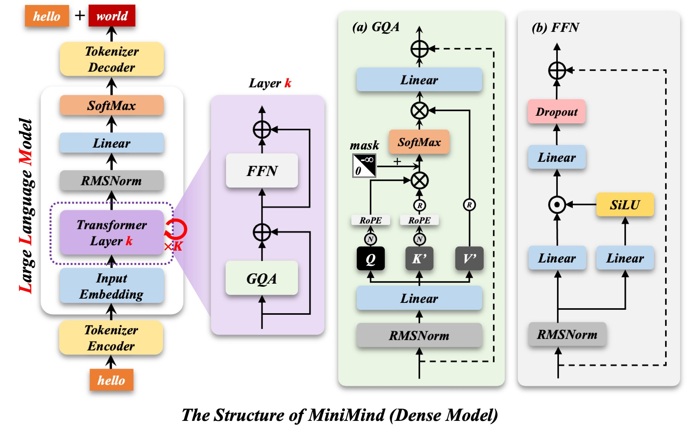
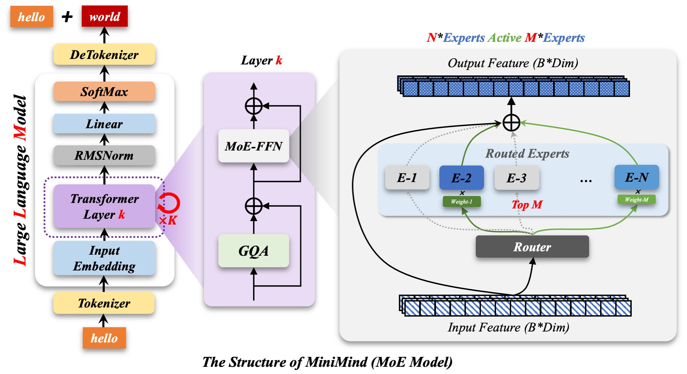

## Minimind

### 启动预训练

将 `pretrain_t2t_mini.jsonl` 放入 `src/minimind/dataset/`，分词器文件放入
`src/minimind/model/`。在项目根目录执行：

```bash
uv run pretrain
```

`uv` 会自动安装项目及锁定依赖，再调用 `pyproject.toml` 中配置的
`minimind.trainer.train_pretrain:main`。

```bash
uv run pretrain --data_path /数据的绝对路径/pretrain_t2t_mini.jsonl
uv run pretrain --help
```

默认分词器、数据和输出路径以源码包的位置为基准，权重保存在 `src/minimind/out/`，
续训断点保存在 `src/minimind/checkpoints/`。显式指定的相对路径按启动目录解析。
也可以使用同一个入口执行 `uv run python -m minimind.trainer.train_pretrain`。

### minimind-3 架构



